# jarness — 设计文档

> v1.3 · 2026-11-01 · 整理稿
> 约定：以图为主；图 ID 稳定；每节 = 一句话定位 → 图 → 规则 → 开放问题。
> 图索引使用 `<a name>` 锚点（GitHub / VS Code / IDE 预览可跳转）。

## 0. 总览

### 0.1 定位

- 单个 JVM daemon；并行度来自**监督树**，不是多进程。
- agent = 受监督的虚拟线程实例；必在监督树中、必绑一个 namespace。
- 状态以**镜像**（SessionStore，默认 SQLite）为唯一权威；**turn = 事务**，commit 才 durable。
- 执行在 daemon 外：默认本机 Rust executor 子进程（长连接回连）；Tool 与 Exec 解耦。
- agent 由 **AgentTemplate** 实例化（模板 ≈ ELF/PE 可执行定义，镜像 ≈ 进程内存）；每个 ns 有自己的 `defaultAgentTemplate`。
- 模型与 agent 解耦：`ModelProfile` 默认属 namespace（ns 级性能考量，≈ CPU 大小核绑定），不进 AgentTemplate；spawn 时可由 manifest 覆盖。

<a name="fig-arch-1"></a>
### 0.2 组件总览（ARCH-1）

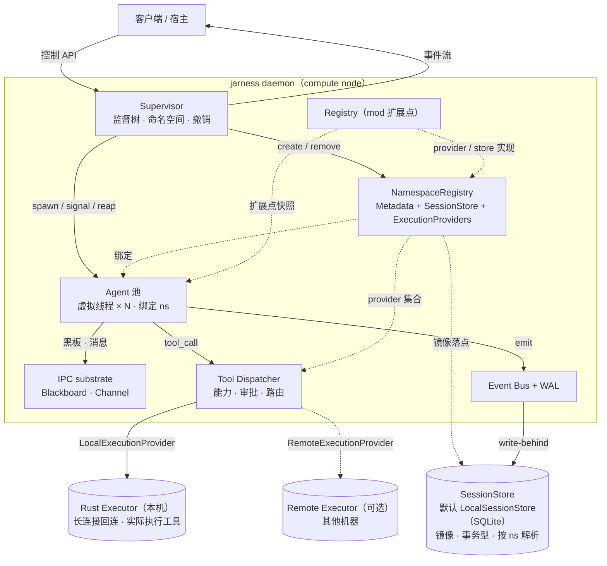

- 先单机；镜像落本机，工具可远端。

<a name="fig-layers-1"></a>
### 0.3 领域分层（LAYERS-1）

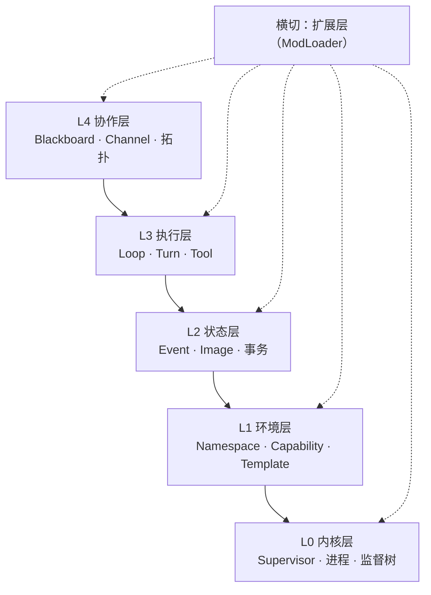

- 依赖自下而上；扩展横切；§1–§6 对应 L0–L4 + 扩展，§7 是决策记录。

### 0.4 不变量

| # | 不变量 |
| --- | --- |
| I1 | 每个 agent 都在监督树中，且绑定且仅绑定一个 namespace |
| I2 | 子 agent 只能经 `Supervisor.spawn / fork` 创建（无裸线程） |
| I3 | 能力与预算沿 spawn 树只减不增：`effective = requested ∩ parent ∩ ns.defaults` |
| I4 | 镜像是唯一权威状态；turn 是事务，commit 才 durable |
| I5 | 副作用只从 core 与 executor 的强制点出去（CAP-2） |
| I6 | agent 由 AgentTemplate 实例化（spawn = exec(template)）或从父镜像 fork（fork = fork(image)） |
| I7 | ModelProfile 默认属 namespace（性能考量），spawn 时可由 manifest 覆盖；不进 AgentTemplate |

<a name="fig-index"></a>
### 0.5 图索引

| 图 | 主题 | 层 |
| --- | --- | --- |
| [ARCH-1](#fig-arch-1) | [组件总览](#fig-arch-1) | 总览 |
| [LAYERS-1](#fig-layers-1) | [领域分层](#fig-layers-1) | 总览 |
| [PROC-1](#fig-proc-1) | [进程模型](#fig-proc-1) | 内核 |
| [TREE-1](#fig-tree-1) | [监督树](#fig-tree-1) | 内核 |
| [TREE-2](#fig-tree-2) | [spawn / fork 时序](#fig-tree-2) | 内核 |
| [FORK-1](#fig-fork-1) | [两种诞生语义](#fig-fork-1) | 内核 |
| [LIFE-1](#fig-life-1) | [生命周期](#fig-life-1) | 内核 |
| [BOOT-1](#fig-boot-1) | [启动序列](#fig-boot-1) | 内核 |
| [CONC-1](#fig-conc-1) | [并发与背压](#fig-conc-1) | 内核 |
| [NS-1](#fig-ns-1) | [namespace 解剖](#fig-ns-1) | 环境 |
| [TEMPLATE-1](#fig-template-1) | [AgentTemplate](#fig-template-1) | 环境 |
| [NS-2](#fig-ns-2) | [namespace 解析](#fig-ns-2) | 环境 |
| [CAP-1](#fig-cap-1) | [能力与衰减](#fig-cap-1) | 环境 |
| [CAP-2](#fig-cap-2) | [强制点](#fig-cap-2) | 环境 |
| [SUPER-1](#fig-super-1) | [超级 agent](#fig-super-1) | 环境 |
| [EVT-1](#fig-evt-1) | [事件模型](#fig-evt-1) | 状态 |
| [IMAGE-1](#fig-image-1) | [进程镜像](#fig-image-1) | 状态 |
| [IMAGE-2](#fig-image-2) | [turn 事务](#fig-image-2) | 状态 |
| [LOCAL-1](#fig-local-1) | [LocalSessionStore](#fig-local-1) | 状态 |
| [LOOP-1](#fig-loop-1) | [Agent Loop](#fig-loop-1) | 执行 |
| [TURN-1](#fig-turn-1) | [Turn 时序](#fig-turn-1) | 执行 |
| [TOOL-1](#fig-tool-1) | [工具调用链](#fig-tool-1) | 执行 |
| [TOOL-4](#fig-tool-4) | [Tool 实现形态](#fig-tool-4) | 执行 |
| [TOOL-2](#fig-tool-2) | [Executor 拓扑](#fig-tool-2) | 执行 |
| [EXEC-1](#fig-exec-1) | [executor 握手与调用](#fig-exec-1) | 执行 |
| [TOOL-3](#fig-tool-3) | [同步 / 异步](#fig-tool-3) | 执行 |
| [IPC-1](#fig-ipc-1) | [IPC 双原语](#fig-ipc-1) | 协作 |
| [IPC-2](#fig-ipc-2) | [共享黑板](#fig-ipc-2) | 协作 |
| [IPC-3](#fig-ipc-3) | [通道](#fig-ipc-3) | 协作 |
| [COLLAB-1](#fig-collab-1) | [协作拓扑](#fig-collab-1) | 协作 |
| [MOD-1](#fig-mod-1) | [ModLoader 结构](#fig-mod-1) | 扩展 |
| [MOD-2](#fig-mod-2) | [mod 生命周期](#fig-mod-2) | 扩展 |
| [MOD-3](#fig-mod-3) | [动态加载](#fig-mod-3) | 扩展 |

### 0.6 术语

| 术语 | 含义 |
| --- | --- |
| Process / Agent | 受 supervisor 管理的虚拟线程实例；有 pid、parent、namespace、预算、能力 |
| AgentTemplate | 可执行定义（≈ ELF/PE）：默认提示词、工具集、循环引用、默认能力；每 ns 有 defaultAgentTemplate |
| ModelProfile | 模型档位：默认 ns 级（性能考量，≈ CPU 大小核绑定），spawn 可被 manifest 覆盖 |
| Image | agent 的唯一权威上下文；存于 SessionStore，可载入 / 本机恢复 |
| Turn | 一次事务：模型调用 + 工具调用的提交单元 |
| SessionStore | 事务型镜像存储接口；可观测性（journal）只是副产物 |
| Namespace | Metadata + SessionStore + ExecutionProviders |
| Capability | 不可伪造的能力句柄；衰减继承 |
| Tool | built-in / mod 声明：schema + requiredCaps + 实现形态（LOCAL / RELAY） |
| ExecutionProvider | 执行后端接口：默认 LocalExecutionProvider，后续可加 RemoteExecutionProvider |
| Executor | daemon 外的 Rust 子进程，实际执行工具并强制能力；每机一个，可远端部署 |
| Mod | 扩展包：工具、循环钩子、策略、provider、store、namespace 模板 |
| Super Agent | 唯一持有平台级能力的 agent：可跨 ns、调用平台工具、管 ns |

## 1. 内核层：进程与监督

> 负责“进程活着、被看见、被限制、被回收”。

<a name="fig-proc-1"></a>
### 1.1 进程模型（PROC-1）

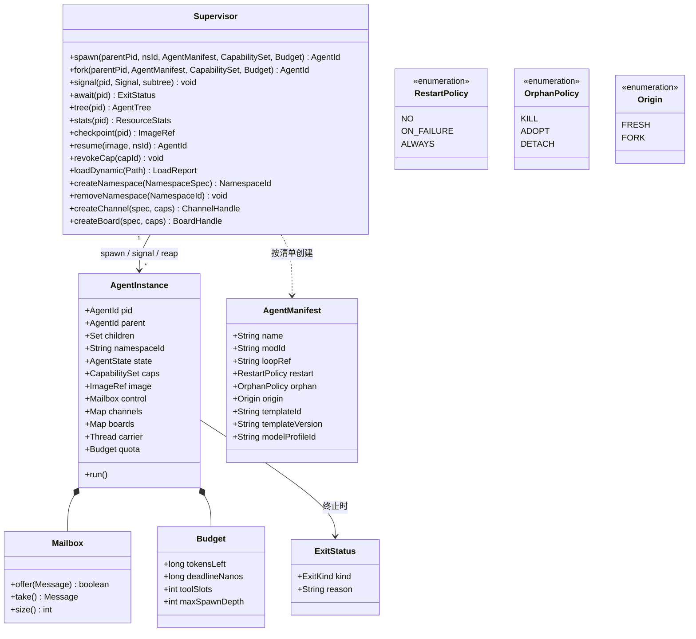

- 控制面走专用 mailbox，数据面走黑板 / 通道。
- 一个 agent = 一条虚拟线程 + 一份预算 + 一份镜像引用。

<a name="fig-tree-1"></a>
### 1.2 监督树（TREE-1）

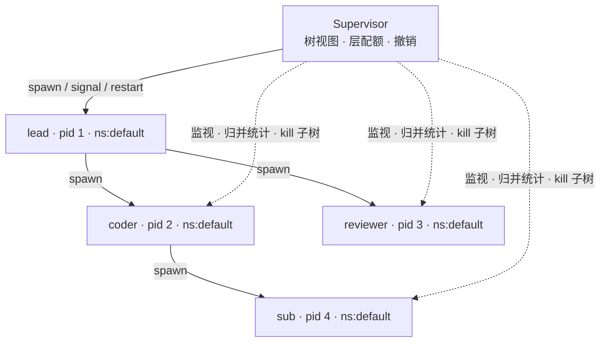

- 层级配额：root → lead → coder → sub 逐层切分，统计向上归并。
- 限额：`maxDepth` + `maxChildren`；不做速率限制。
- 孤儿：父死 → kill 子树；`ADOPT` / `DETACH` 暂不实现。
- 跨 ns / 平台工具：仅 super agent 允许。

<a name="fig-tree-2"></a>
### 1.3 spawn / fork 时序（TREE-2）

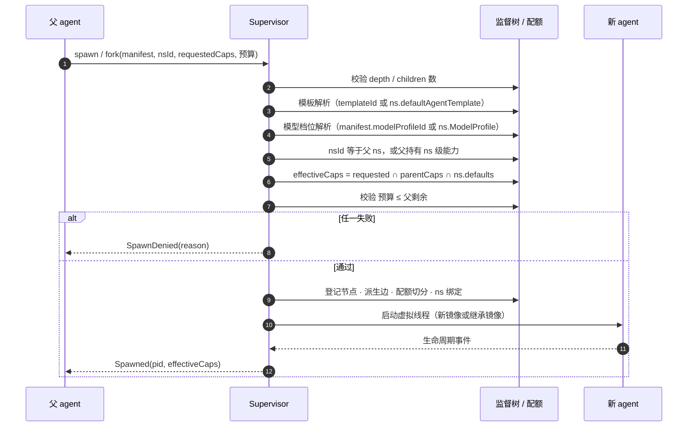

- 拒绝也是事件：超深、超宽、超预算、越权、跨 ns 五类。

<a name="fig-fork-1"></a>
### 1.4 两种诞生语义（FORK-1）

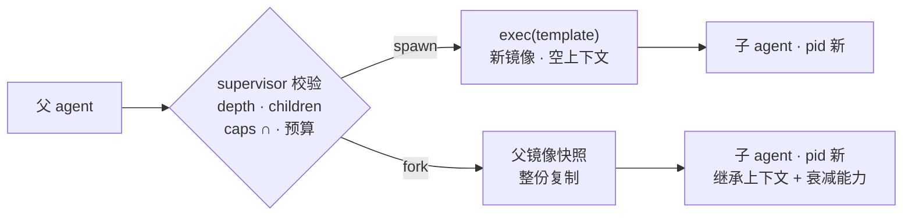

- `spawn` = `exec(template)`（空镜像起步）；`fork` = `fork(image)`（父镜像整份复制）。
- 不做 COW：会让需要 override 前序 turn 的 mod 承担额外心智负担。

<a name="fig-life-1"></a>
### 1.5 生命周期（LIFE-1）

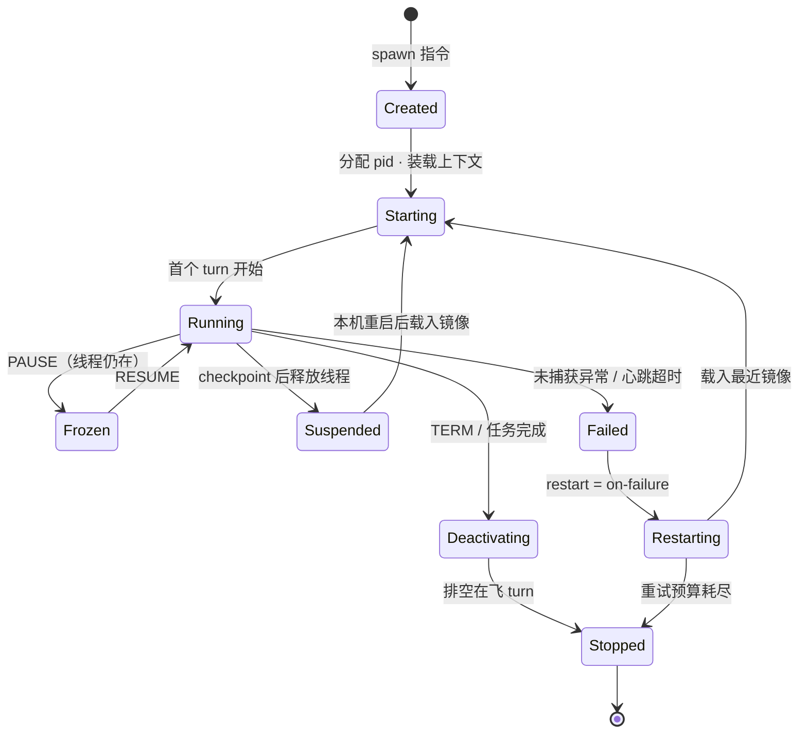

- `Frozen`：内存内暂停（句柄仍有效）；`Suspended`：镜像态（仅本机恢复）。
- 不可迁移状态（IPC 句柄 / provider 连接）恢复时显式失败。

<a name="fig-boot-1"></a>
### 1.6 启动序列（BOOT-1）

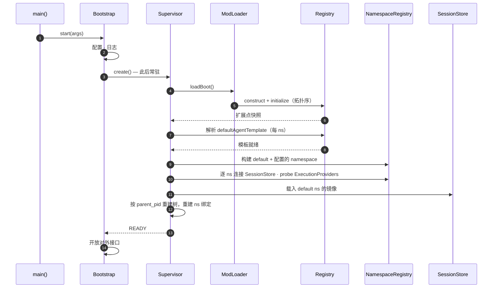

- 默认 LocalSessionStore 启动时打开工作目录 DB；provider 缺失只影响路由，不阻塞启动。
- 启动时组装 AgentTemplate 并解析每 ns 默认模板；模板缺失 → spawn 拒绝。

<a name="fig-conc-1"></a>
### 1.7 并发与背压（CONC-1）

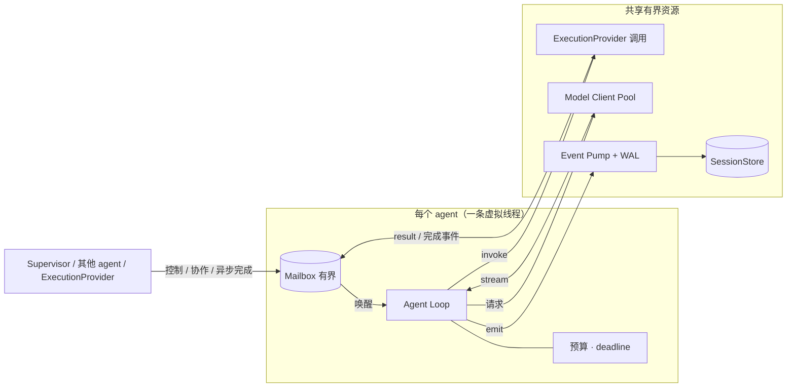

- 背压点：mailbox、channel buffer、provider 并发槽、镜像写入积压、模型 429。
- 异步工具把等待移进 mailbox：不占线程，但会拉长 turn 生命周期。

↑ [返回图索引](#fig-index)

## 2. 环境层：namespace 与能力

> 回答两个问题：上下文“是什么 / 存在哪”，以及“在哪跑、能碰什么”。

<a name="fig-ns-1"></a>
### 2.1 namespace 解剖（NS-1）

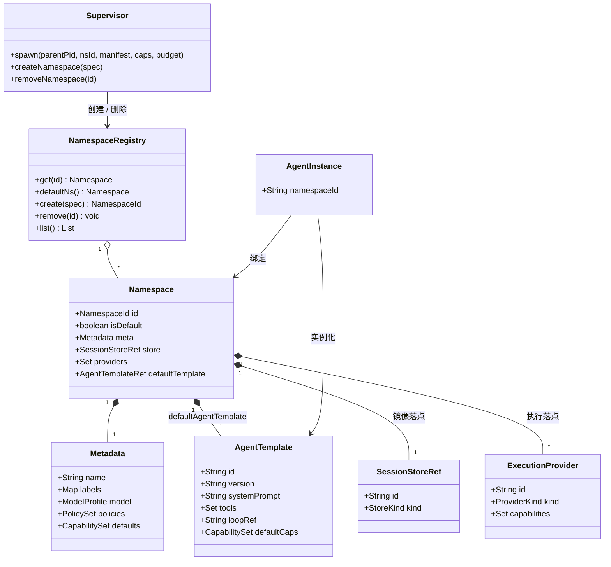

- Metadata（模型配置 / 策略 / 默认能力 / 标签）决定“是什么”。
- SessionStore 决定“镜像存在哪”；ExecutionProviders 决定“代码在哪跑”。
- 每 ns 有 `defaultAgentTemplate`；manifest 指定 `templateId` 时覆盖（见 TEMPLATE-1）。
- 模型选择默认属 Metadata 的 ModelProfile（ns 级性能考量，≈ 大小核绑定）；spawn 时 manifest 可覆盖。
- store 每 ns 单份；要合成时由 mod 包装 composite store 再挂进 ns（ExecutionProvider 同理）。
- `default` 永远存在；缺省 provider = LocalExecutionProvider。

<a name="fig-template-1"></a>
### 2.2 AgentTemplate（TEMPLATE-1）

> Template ≈ ELF/PE（可执行定义）；Image ≈ 进程内存（运行态）。

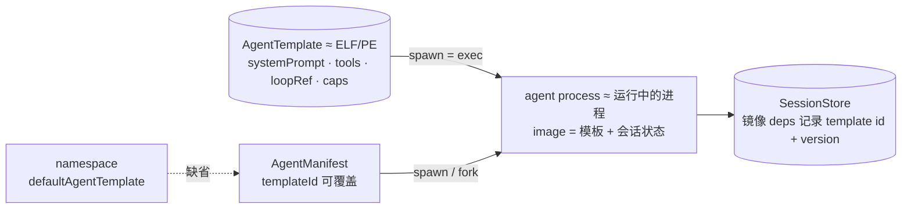

- 内容：id / version / systemPrompt / tools / loopRef / defaultCaps。
- 模板不含模型选择：默认取 ns Metadata 的 ModelProfile，manifest 可在 spawn 时覆盖。
- 解析：`manifest.templateId` > `ns.defaultAgentTemplate`；模板缺失 → spawn 拒绝。
- 镜像 deps 记录 templateId + version，恢复时校验（不满足见 IMAGE-1）。

<a name="fig-ns-2"></a>
### 2.3 namespace 解析（NS-2）

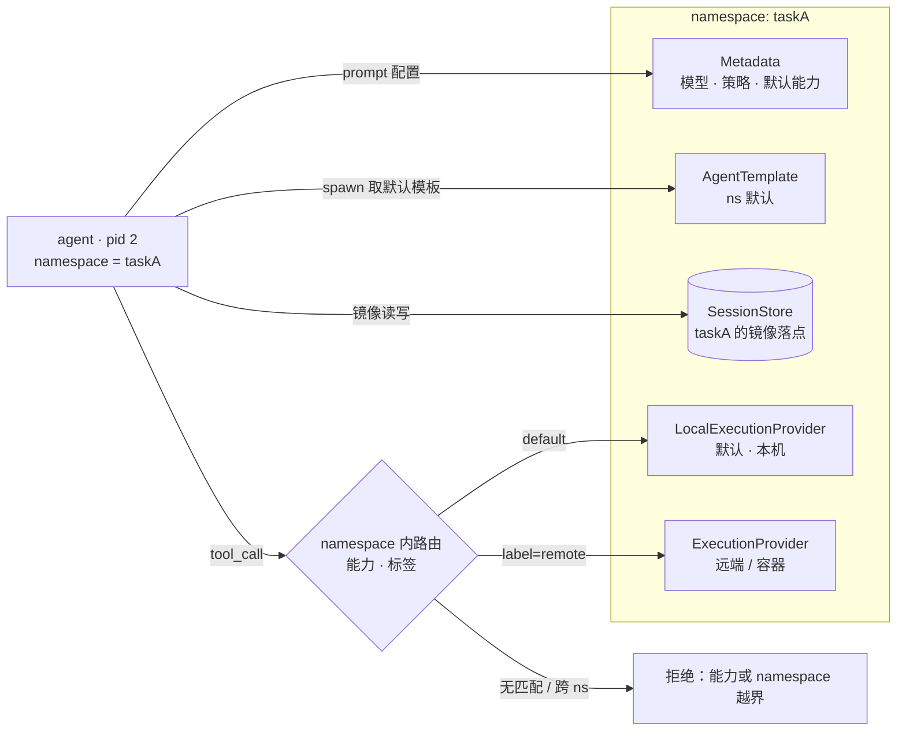

- 解析顺序：agent → namespace → (store | provider)；跨 ns 默认拒绝（super agent 例外）。

<a name="fig-cap-1"></a>
### 2.4 能力与衰减（CAP-1）

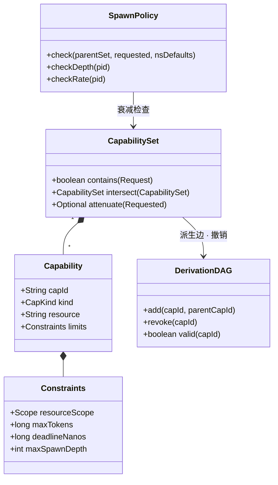

- core 只负责：定义 kind / resource / constraints、衰减、派生撤销；scope 语义由执行侧解释。
- 继承：`effective = requested ∩ parent ∩ ns.defaults`，约束只能更窄。
- 撤销：按派生 DAG 级联；下次使用硬失败，在飞调用收到取消。

<a name="fig-cap-2"></a>
### 2.5 强制点（CAP-2）

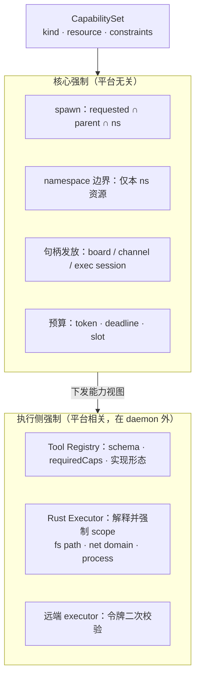

- 分界：core 做定义 / 衰减 / 句柄 / 预算；执行侧做解释 / 强制。
- 同一 capability 在不同平台语义不同 → 执行侧翻译；跨进程后不再是 JVM 内协作式检查。
- 唯一平台级例外：super agent 持有 platform caps。

<a name="fig-super-1"></a>
### 2.6 超级 agent（SUPER-1）

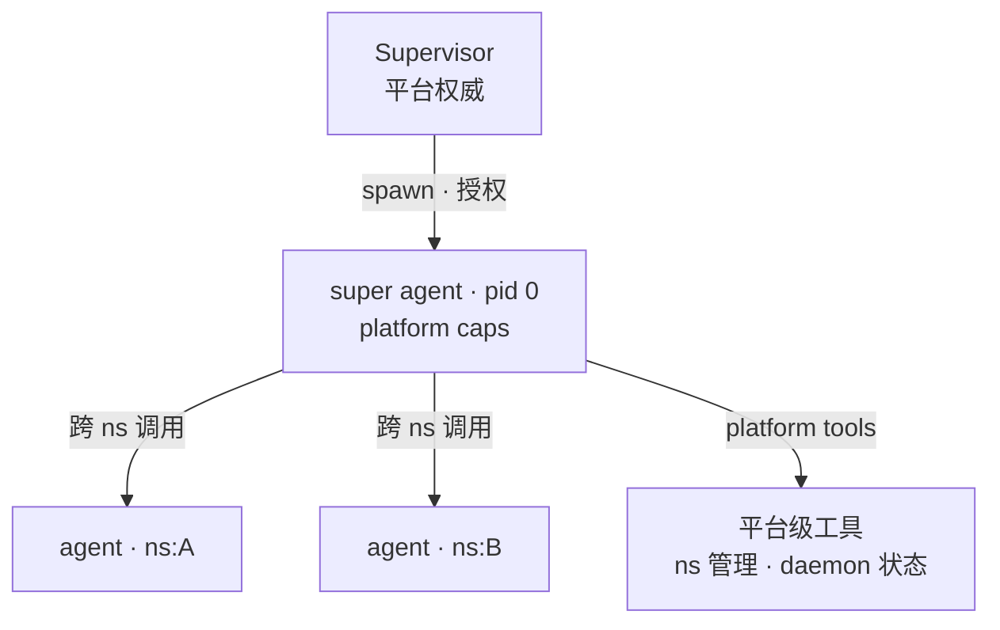

- 创建：启动 profile 控制是否创建（默认 1 个）；权限：跨 ns + 平台工具 + ns 管理。
- kill：只接受来自外部 jarness 平台的信号；ns 内 agent 发消息无法 kill。

↑ [返回图索引](#fig-index)

## 3. 状态层：镜像与事务

> 镜像 = 权威上下文；turn = 事务；崩溃 = 回滚到最近 commit。

<a name="fig-evt-1"></a>
### 3.1 事件模型（EVT-1）

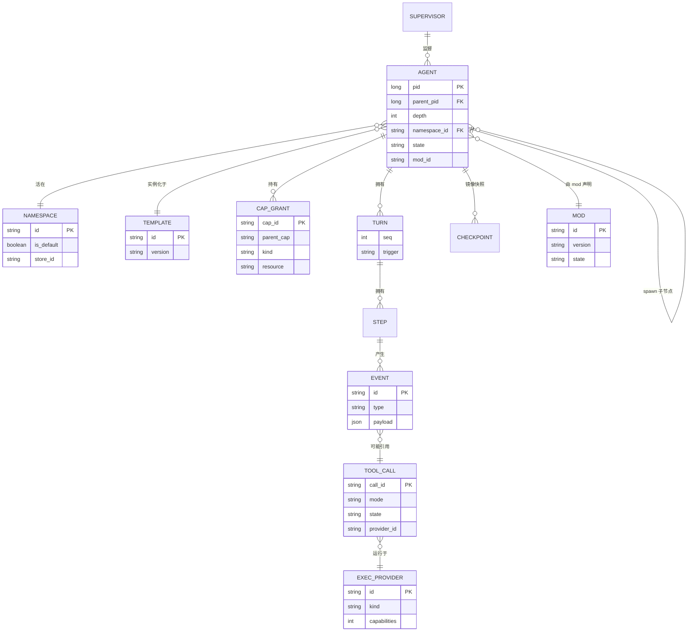

- 镜像（权威）与事件（观测）分开：CHECKPOINT 可直接启动 agent；事件流用于回放 / 审计。
- 树、能力授权 / 撤销、ns 绑定既产生事件，也进镜像。

<a name="fig-image-1"></a>
### 3.2 进程镜像（IMAGE-1）

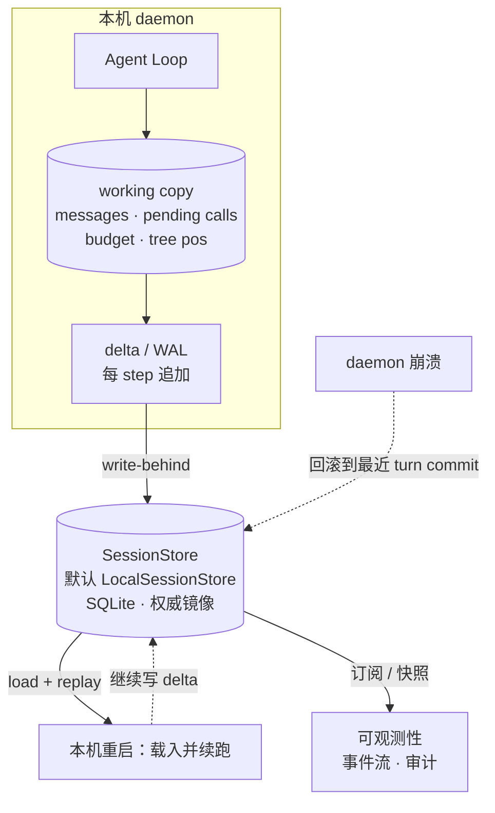

| 状态 | 进镜像 | 说明 |
| --- | --- | --- |
| messages / turn 上下文 | 是 | 恢复上下文 |
| 预算计数 | 是 | 防止重启后刷新预算 |
| pending 异步调用 | 是 | callId + 幂等键 |
| 能力派生边 | 是 | 重启后重新校验 |
| 依赖清单（mod / tool / loop / template） | 是 | 恢复前校验 |
| ns 绑定 | 是 | 恢复时解析 namespace |
| IPC 句柄 / 黑板句柄 | 否 | 本地对象；重启后显式失败 |
| provider 连接 / 子进程 / 终端 | 否 | 重启后需重建 |

- 崩溃窗口 = 最近已提交 turn 之后；未提交 turn 整体回滚。
- 依赖不满足 → 拒绝加载；强制加载时注入系统提示词「tool 已发生降级，当前可用 tools：…」。
- 单机阶段不做跨节点漂移。

<a name="fig-image-2"></a>
### 3.3 turn 事务（IMAGE-2）

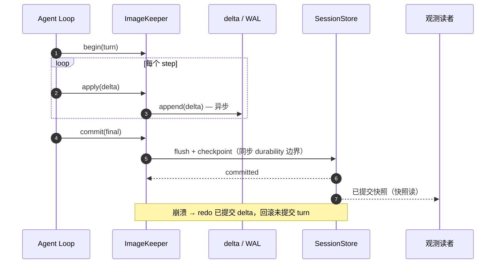

| 数据库概念 | jarness |
| --- | --- |
| transaction begin | turn 开始 |
| statement | step（模型 / 工具调用） |
| WAL | delta log（每 step 追加，可异步） |
| commit | turn 完成，同步 flush 到 store |
| rollback | 崩溃或中止：丢弃未提交 turn |
| checkpoint | 镜像快照（异步 compaction） |
| single writer | 每 agent 单写者 |
| read snapshot | 观测读者读已提交快照 |

- durability 边界只有一个：turn commit；turn 内 step 可丢。
- commit = 一次 SQLite 事务（WAL + `synchronous=FULL`）；checkpoint 异步 compaction。

<a name="fig-local-1"></a>
### 3.4 LocalSessionStore（LOCAL-1）

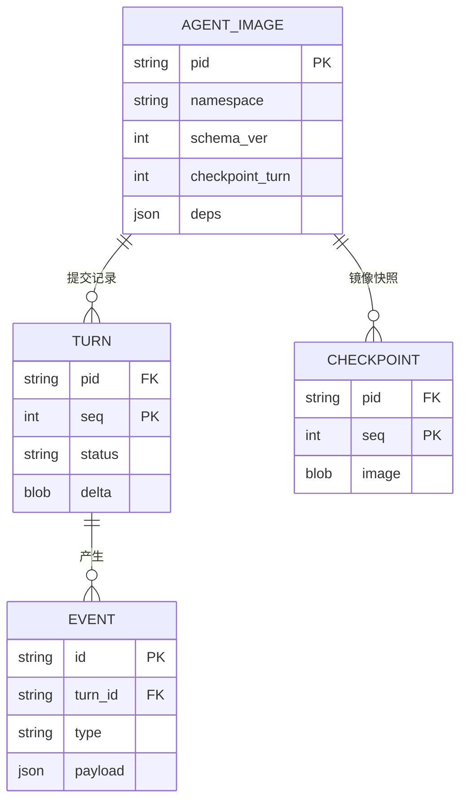

- 位置：`<jarness_home>/data/jarness.db`，WAL 模式；先单文件承载本机全部 namespace。
- turn commit 原子写 `turn` + `event` + 更新 `agent_image`；`synchronous=FULL`。
- 恢复：checkpoint 快照 + 重放 `status=committed` 的 turn；未提交丢弃；只读连接做观测。
- 存储选型：SQLite（默认）；H2 MVStore（纯 Java 退路）；DuckDB 只适合观测面；冷观测 v1 不做。

↑ [返回图索引](#fig-index)

## 4. 执行层：循环、轮次与工具

> agent 真正“思考与行动”的地方；只依赖下层的预算、能力、事务与路由。

<a name="fig-loop-1"></a>
### 4.1 Agent Loop（LOOP-1）

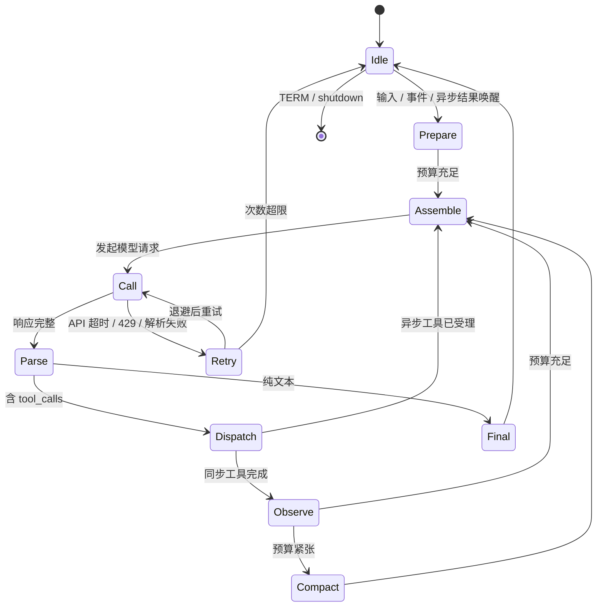

- 异步结果一律经 mailbox 发新 turn；当前 turn 只看 `accepted(callId)`。
- pending 异步调用进镜像，恢复后对账同一 callId（幂等键防重）。
- API 超时退避重试；工具超时不重试（返回 timeout + 幂等去重）。

<a name="fig-turn-1"></a>
### 4.2 Turn 时序（TURN-1）

```mermaid
sequenceDiagram
  autonumber
  participant U as 事件源
  participant L as Agent Loop
  participant C as Context Assembler
  participant M as Model
  participant T as Tool Dispatcher
  participant O as Outbox

  U->>L: 输入 / 异步结果 / 定时唤醒
  L->>C: assemble(messages, tools, budget)
  C-->>L: prompt + 预算切分
  L->>M: stream(prompt)
  M-->>L: tokens / tool_calls
  alt 同步工具
    L->>T: invoke(mode=SYNC, deadline)
    T-->>L: result / timeout
  else 异步工具
    L->>T: invoke(mode=ASYNC)
    T-->>L: callId（立即）
    Note over L: 结果稍后经 mailbox 发新 turn
  end
  L->>O: emit(events) — 不等待写盘
```

- 事件发射与镜像写入解耦于 loop；一致性契约见 IMAGE-2。

<a name="fig-tool-1"></a>
### 4.3 工具调用链（TOOL-1）

```mermaid
flowchart LR
  TC["tool_call<br/>id · mode · deadline"] --> V{"schema / 参数校验"}
  V -->|失败| R1["tool_error"]
  V -->|通过| CAP{"能力校验<br/>requiredCaps ⊆ caps<br/>Tool / Executor 自检"}
  CAP -->|拒绝| R0["capability_denied"]
  CAP -->|通过| CL{"副作用等级<br/>mod 声明 + 宿主复核"}
  CL -->|只读| RT["路由"]
  CL -->|写入 / 外溢| AP{"approval policy"}
  AP -->|ask| H{"人工批准<br/>可异步等待"}
  H -->|拒绝| R2["denied"]
  H -->|允许| RT
  AP -->|never| RU{"规则白名单"}
  RU -->|命中| RT
  RU -->|未命中| R3["blocked"]
  RT --> K{"Tool 实现形态"}
  K -->|LOCAL| LEX["daemon 内闭环执行"]
  K -->|RELAY| P{"namespace 内选 provider<br/>能力 · 标签 · 负载"}
  P -->|无匹配| R4["execution_failed"]
  P --> EX["ExecutionProvider.invoke"]
  LEX --> RES["completed / failed / timeout / cancelled"]
  EX --> RES
  RES --> OBS["回注 observation"]
  R0 --> OBS
  R1 --> OBS
  R2 --> OBS
  R3 --> OBS
  R4 --> OBS
```

- 审批可异步（ask 挂起 → 决策事件 → 继续），复用 SYNC / ASYNC 机制。
- LOCAL 在 daemon 内闭环；RELAY 交给 provider，缺 provider → `execution_failed`（不降级）。

<a name="fig-tool-4"></a>
### 4.4 Tool 实现形态（TOOL-4）

```mermaid
flowchart TB
  subgraph DECL["Tool 声明（built-in / mod）"]
    T["Tool<br/>schema · requiredCaps"]
  end
  subgraph IMPL["实现形态（二选一）"]
    L["LOCAL：daemon 内 handler"]
    R["RELAY：providerSelector"]
  end
  subgraph EXEC["执行"]
    P["ExecutionProvider"]
    X["Rust Executor"]
  end
  T --> L
  T --> R
  L --> D["在 daemon JVM 内执行"]
  R --> P
  P --> X
  R -.->|provider 缺失| F["execution_failed"]
```

- built-in / mod 注册的是声明：schema + requiredCaps + 实现形态。
- agent 可用工具集 = 模板 tools ∩ 能力授权；模板决定默认工具集（见 TEMPLATE-1）。
- RELAY 缺少对应 provider：直接失败，不静默回退。

<a name="fig-tool-2"></a>
### 4.5 Executor 拓扑（TOOL-2）

```mermaid
flowchart TB
  subgraph DAEMON["jarness daemon"]
    TD["Tool Dispatcher"]
    EP["ExecutionProvider 接口"]
    LE["LocalExecutionProvider"]
    RP["RemoteExecutionProvider（可选）"]
  end
  subgraph LOCALM["本机"]
    RX["Rust Executor 子进程<br/>fs / net / process 工具"]
  end
  subgraph REMOTEM["其他机器（可选）"]
    RR["Rust Executor"]
  end
  TD --> EP
  EP --> LE
  EP -.-> RP
  LE -->|call / cancel| RX
  RX -->|result / event| LE
  RP -.->|网络长连接| RR
  RR -.->|result| RP
```

- 默认：daemon 启动本机 executor 子进程，executor 主动长连接回连；LocalExecutionProvider 只是桥。
- 每台机器一个 executor；崩溃重启交给实现层 ExceptionHandler，core 只标 provider dead、在飞调用失败。
- 远端同一份二进制部署，回连后由 RemoteExecutionProvider 对接；能力映射发生在 executor 内。

<a name="fig-exec-1"></a>
### 4.6 executor 握手与调用（EXEC-1）

```mermaid
sequenceDiagram
  autonumber
  participant E as Rust Executor
  participant D as Daemon（listener）
  participant P as ExecutionProvider
  participant T as Tool Dispatcher

  E->>D: connect（executorID · token · 平台信息）
  D->>E: hello-ack（协议版本 · 能力 schema）
  E->>D: advertise（tools · requiredCaps）
  D->>P: bind
  T->>P: invoke(callId, tool, args, deadline, capToken)
  P->>E: call(callId, ...)
  E-->>P: result / error / progress
  P-->>T: result
  Note over E,D: 长连接复用；executor 崩溃 → provider 标 dead，在飞调用失败
```

- 回连方向：executor 发起、daemon 是 listener → 远端部署不需要额外入站端口。
- 非阻塞多路复用：单连接按 callId 复用，帧 call / cancel / progress / result；per-stream credit 流控。
- 认证：本机一次性 secret（env/stdin）+ HMAC；远端 enrollment token + TLS；未认证直接断开。
- 防 C2：只接受已配置 executor，限制可调用工具集，所有 call 进审计。

<a name="fig-tool-3"></a>
### 4.7 同步 / 异步（TOOL-3）

```mermaid
sequenceDiagram
  autonumber
  participant A as Agent
  participant D as Dispatcher
  participant P as ExecutionProvider

  A->>D: invoke(mode, deadline, idempotencyKey)
  alt mode = SYNC
    D->>P: invoke(callId)
    alt 按期完成
      P-->>D: result
      D-->>A: 阻塞返回 result
    else 超时
      D->>P: cancel(callId) 尽力而为
      D-->>A: timeout 结果
    end
  else mode = ASYNC
    D-->>A: 立即返回 callId
    D->>P: invoke(callId)
    P-->>D: result
    D-->>A: 完成事件 → mailbox
  end
```

- `mode` 是调用级选项；超时结果按 callId 丢弃，重试靠幂等键。
- 异步完成事件作为 mailbox 消息开启新 turn。

↑ [返回图索引](#fig-index)

## 5. 协作层：IPC 与拓扑

> 只提供原语（共享状态 + 消息流）；协作协议留给 mod。

<a name="fig-ipc-1"></a>
### 5.1 IPC 双原语（IPC-1）

```mermaid
flowchart TB
  SUP["Supervisor<br/>命名空间 · 授权"]
  BB[("Blackboard<br/>命名区域 · 版本化 cell")]
  CH[("Channel<br/>会合 / 有界")]
  A1["agent:lead · ns:default"]
  A2["agent:coder · ns:default"]
  A3["agent:reviewer · ns:default"]
  SUP -->|create + 发句柄| BB
  SUP -->|create + 发句柄| CH
  A1 -->|句柄即能力| BB
  A2 -->|句柄即能力| BB
  A3 -->|句柄即能力| BB
  A1 -->|send / recv| CH
  A2 -->|send / recv| CH
  A3 -->|send / recv| CH
```

- 黑板 = 共享状态（shm）；通道 = 消息流（chan）；句柄即能力，pid 死则回收。
- IPC 先做 daemon 内，跨 daemon 不在范围内。

<a name="fig-ipc-2"></a>
### 5.2 共享黑板（IPC-2）

```mermaid
sequenceDiagram
  autonumber
  participant W1 as Writer A
  participant W2 as Writer B
  participant B as Blackboard
  participant R as Watcher

  W1->>B: read cell v=3
  W2->>B: read cell v=3
  W1->>B: CAS write expected v=3 → v=4
  B-->>W1: ok
  W2->>B: CAS write expected v=3 → 冲突
  B-->>W2: conflict
  W2->>B: 重读 v=4 · 重算
  W2->>B: CAS write expected v=4 → v=5
  B-->>W2: ok
  B-->>R: watch 通知 v=5
```

- 悲观锁 + 乐观 CAS 都给，默认 CAS；`watch` = 条件变量 / futex 的 Java 等价。

<a name="fig-ipc-3"></a>
### 5.3 通道（IPC-3）

```mermaid
classDiagram
  class Channel~T~ {
    +send(T) void
    +trySend(T) boolean
    +recv() T
    +tryRecv() Optional~T~
    +close()
    +select(ops, timeout) Result
  }
```

| Go chan / POSIX | jarness |
| --- | --- |
| `make(chan T)` | `createChannel(cap=0)`，无缓冲 = 会合 |
| `cap > 0` | 有界 buffer，满则 send 阻塞（背压） |
| `close` | send 抛 Closed；recv 返回 closed 信号 |
| `select` | 多通道等待 + 超时 + default |
| 多消费者 | 每条消息只被一个接收者取走 |

- 广播另做：topic / 每订阅者独立邮箱，不复用单消费者通道。

<a name="fig-collab-1"></a>
### 5.4 协作拓扑（COLLAB-1）

```mermaid
flowchart TB
  LEAD["lead · pid 1"]
  C["coder · pid 2<br/>caps ⊆ lead"]
  R["reviewer · pid 3<br/>caps ⊆ lead"]
  BB[("Blackboard: task-board<br/>cell + 版本")]
  CH[("Channel: handoff")]
  EP[("namespace 内 ExecutionProvider<br/>共享执行环境")]
  LEAD -->|spawn + 衰减 caps| C
  LEAD -->|spawn + 衰减 caps| R
  LEAD -->|写任务| BB
  C -->|CAS claim| BB
  R -->|读结果| BB
  C -->|notify| CH
  CH -->|deliver| R
  C -->|fs / exec 工具| EP
  R -->|fs / exec 工具| EP
  LEAD -->|review| EP
```

- 运行时只提供原语；task board / claim 协议建议做成内置 mod。
- “文件共享”不是 core 概念：同一 namespace 内同一 provider 的副作用。

↑ [返回图索引](#fig-index)

## 6. 扩展层：ModLoader

> 横切所有层：工具、钩子、策略、provider、store、namespace 模板都从这里进来。

<a name="fig-mod-1"></a>
### 6.1 结构（MOD-1）

```mermaid
classDiagram
  class Supervisor {
    +loadDynamic(Path) LoadReport
  }
  class ModLoader {
    -Path modsRoot
    -Map loaded
    +scan() List
    +resolve() LoadPlan
    +loadBoot() BootReport
    +loadDynamic(Spec) LoadReport
    +disable(String)
  }
  class ModContainer {
    +String id
    +ModMetadata meta
    +ModState state
    +construct()
    +initialize(Registry)
    +deactivate()
  }
  class ModMetadata {
    +String id
    +String version
    +String apiVersion
    +List dependencies
  }
  class Registry {
    +tools()
    +loopHooks()
    +policies()
    +agentTemplates()
    +executionProviders()
    +sessionStores()
    +namespaceTemplates()
    +snapshot() Snapshot
  }
  class DependencyResolver {
    +topoSort() LoadPlan
    +checkVersion() Report
  }
  Supervisor --> ModLoader : loadDynamic
  ModLoader "1" *-- "*" ModContainer
  ModContainer *-- ModMetadata
  ModContainer --> Registry : 注册扩展点
  ModLoader ..> DependencyResolver
```

- 扩展点：Tool / LoopHook / Policy / ContextAssembler / AgentTemplate / ExecutionProvider / SessionStore / NamespaceTemplate。
- 纯声明式注册，不做 ASM / Mixin / 事件总线改写；`jarness-api` 独立，Registry 对 agent 只读快照。

<a name="fig-mod-2"></a>
### 6.2 生命周期（MOD-2）

```mermaid
stateDiagram-v2
  [*] --> Discovered: 扫描 mods/
  Discovered --> Resolved: 依赖与版本校验
  Resolved --> Constructed: 建 classloader · 实例化
  Constructed --> Initialized: 向 Registry 注册
  Initialized --> Active: 快照对外可见
  Discovered --> Failed: 校验失败
  Resolved --> Failed: 依赖缺失
  Constructed --> Failed: 初始化抛错
  Failed --> [*]
```

- 仅加载、不卸载（DLL 语义）；换版本 = 重启 daemon。

<a name="fig-mod-3"></a>
### 6.3 动态加载（MOD-3）

```mermaid
sequenceDiagram
  autonumber
  participant S as Supervisor
  participant M as ModLoader
  participant R as Registry
  participant A as 运行中的 Agent

  S->>M: loadDynamic(path)
  M->>M: 校验 metadata · 依赖 · 冲突
  alt 校验失败
    M-->>S: LoadReport(failed, reason)
  else 通过
    M->>M: 建 classloader · 实例化 · 初始化
    M->>R: 追加扩展点（单线程串行化）
    R-->>M: Snapshot v+1
    R-->>A: 下一 turn 读新快照
    M-->>S: LoadReport(ok)
  end
  Note over A: 在飞的 turn 仍用旧快照
```

- 所有热操作走 supervisor 单线程命令队列；动态加载只增，不提供卸载 / 热替换。

↑ [返回图索引](#fig-index)

## 7. 决策记录

### 7.1 已定

| 领域 | 结论 |
| --- | --- |
| 内核 | JDK 21；虚拟线程 per agent；树状监督；父死 kill 子树；限额 maxDepth + maxChildren，无速率限制 |
| 环境 | Namespace = Metadata（ModelProfile / 策略 / 默认能力 / 标签）+ 单份 SessionStore + ExecutionProviders + defaultAgentTemplate；跨 ns 与平台工具仅 super agent（profile 控制创建，外部信号可 kill，可管 ns） |
| 模板 | AgentTemplate ≈ ELF/PE：systemPrompt / tools / loopRef / defaultCaps；manifest 可覆盖 ns 默认；模板不含模型选择，但 manifest 可在 spawn 时覆盖模型档位 |
| 状态 | 镜像为唯一权威；turn 事务、commit durable；WAL + checkpoint；SQLite 单文件；不可迁移状态显式失败；依赖不满足拒绝加载，`--force` 时注入降级提示词 |
| 执行 | 本机 Rust executor 每机一个、长连接回连；Tool 与 Exec 解耦（LOCAL / RELAY，缺 provider 直接失败）；SYNC / ASYNC；API 重试、工具超时 cancel + 幂等 |
| 能力 | core 定义 + 衰减 + 撤销；执行侧解释并强制；资源级粒度；fork 整份复制、不做 COW |
| 协作 | 黑板 + 通道（daemon 内）；句柄即能力；悲观锁 + CAS，默认 CAS |
| 扩展 | mod 仅加载（DLL），纯声明式；supervisor 串行热加载 |
| 观测 | store 快照 + CDC；冷观测 v1 不做；checkpoint 阈值暂不调优 |

### 7.2 待定

| # | 问题 | 影响图 | 当前倾向 |
| --- | --- | --- | --- |
| Q36 | 远端 TLS 是否强制 / secret 轮换策略 | EXEC-1 | 远端强制 TLS；本机 loopback 免 |
| Q37 | executor 协议帧格式：JSON-lines 起步 vs protobuf / flatbuffers | EXEC-1 | JSON-lines 起步 |
| Q38 | manifest 覆盖模型档位是否受 ns 允许集 / 预算约束 | TEMPLATE-1 / TREE-2 | 待定 |

### 7.3 变更记录

| 版本 | 变更 |
| --- | --- |
| v1.0 | 由 v0.5–v0.12 手稿整理：统一镜像 / 事务术语、压缩决策记录、图索引改为内联锚点、结构自下而上分层 |
| v1.1 | 新增 AgentTemplate（模板 ≈ ELF/PE，每 ns 有 defaultAgentTemplate）；ExecProvider 全量更名为 ExecutionProvider |
| v1.2 | 明确 ModelProfile 属 ns（性能考量，≈ 大小核绑定），与 AgentTemplate 解耦 |
| v1.3 | spawn 允许 manifest 覆盖模型档位；新增 Q38（覆盖是否受 ns 允许集约束） |
